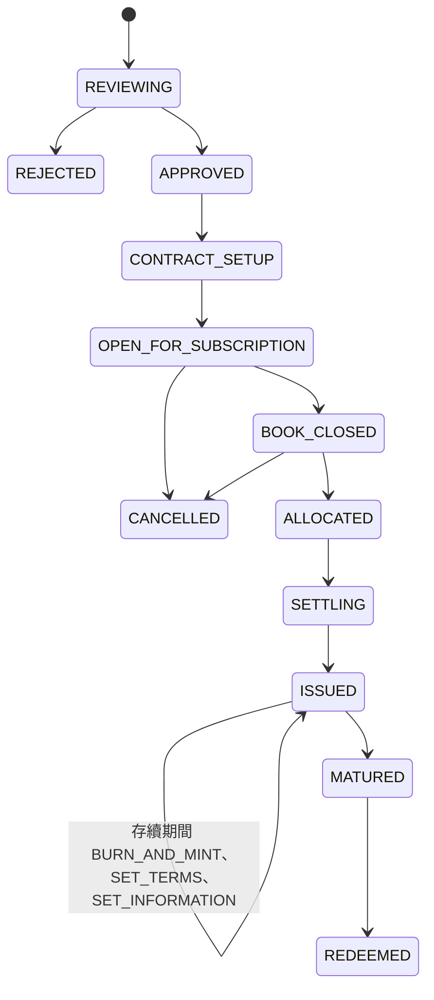

# DigiQuick bond 改用冷錢包 CMTAT：整體改動說明

- 日期：2026-11-25
- 線上版：https://claude.ai/artifact/VjrztvJniHZbBPMqGFn9Hd

## 1. 背景與目標架構

bond 改成由冷錢包系統部署和操作 CMTAT 合約，DigiQuick 不再持有任何私鑰、不再簽交易、也不再自己上鏈。DigiQuick 的角色是發行運營中樞：處理業務，再把每個業務動作轉成結構化的請求送給冷錢包；鏈上結果透過 webhook 和查詢取回。

依據是冷錢包 Open API 串接指南 v0.7（`dacc_chainfusion_docs/digiquick-integration-guide-v0.7.md`）、Aegis 對第 10 節的回覆（`dacc_chainfusion_docs/digiquick-v0.7-questions-and-answers.md`），以及對 digiquick-api、digiquick-admin、digiquick-app、digiquick-contracts 四個 repo 的程式碼核對。其他 8 種資產維持原本的 TokenFactory 路徑，不受影響。

| 職責 | DigiQuick | 冷錢包系統（Aegis） |
| --- | --- | --- |
| 簿記配售 | 開放認購、收認購單；發行方在 APP 做分配、admin 覆核；檢查發行量與最低面額 | — |
| 身份合規 | 發行方公司 KYC、機構與個人投資人 KYC 與資格審核、決定 allowlist 的開或關 | 審核客戶申請；登記外部地址時做 KYT |
| 交割編排 | 分配後開 allowlist、付款確認後才 mint、分批、排序 | 執行 allowlist 與 mint |
| 登記 | 鏈下持有人登記冊（權威）、三方對帳、記錄日快照 | 提供鏈上持有人、餘額、凍結狀態查詢 |
| 生命週期 | bond 狀態機、轉讓、修改條款、付息資料、到期贖回 | 暫停、凍結、強制轉移、停用（只能在 Aegis 後台操作） |
| 送出業務意圖 | 產生 referenceId、送請求、接 webhook、輪詢對帳 | 人工審核、簽名、廣播、記帳 |
| 私鑰與簽名 | 只有呼叫 API 用的 RSA 金鑰 | 所有錢包的私鑰、離線簽名、廣播；gas 由 Aegis 負擔並補充 |

## 2. 已定的前提

- **投資人分機構和個人兩種**：USDSN27 的發行對象是機構投資人（Aegis 回覆第 1 題）。發行方是公司。
- **先做機構投資人**：首發只做發行方和機構投資人。個人投資人分支（個人註冊、`Role.INVESTOR`、個人 KYC、個資加密）放到第二階段；本文件保留它的設計，標為「第二階段」，資料模型先預留 `Investor.type`，之後加個人分支不用改認購、分配和交割。
- **發行方和投資人用同一個註冊入口**：註冊時先選身份。發行方和機構投資人都走公司註冊（`Company` 加上員工帳號 `Customer`），用 `Company.kind` 區分；個人投資人走新的個人分支，不建立公司（第 4 節）。
- **發行方和投資人都在 APP（digiquick-app）看到發行和認購的債權狀況**，各自只看得到自己有權看的部分（第 5 節）。
- **簽名和廣播都在冷錢包系統**：admin 和 APP 都不再連接 MetaMask 或其他錢包。
- **只用託管錢包**：正式環境要等 Conflux 的 KYT 接上後才能登記外部地址和提領（指南 §7.2、§13），所以首發不開放外部地址。
- **指南 v0.7 仍是串接規格草稿**，欄位可能微調。開發先用 mock server，Aegis dev 環境可用後再驗證。
- 付款在鏈外：CMTAT 和冷錢包都不處理現金。**款到才 mint**：分配確定後只把獲配投資人的託管錢包加進 allowlist；DigiQuick 確認某位投資人款項到帳後，才用 `BATCH_MINT` 把代幣發到該投資人的託管錢包。代幣一經發出就是已付款的持倉，不需要鎖倉，也不需要 Aegis 新增操作（指南已有 `BATCH_MINT`）。
  - 鏈上 `totalSupply` 會隨付款分批增加，全部付款確認後才等於實際發行量；沒有賣出的額度不會 mint；逾期未付款的獲配額度在 DigiQuick 內註銷（第 6.2 節），因為從未上鏈，鏈上不需要 `BATCH_BURN`。
  - 不採用「先 mint 再鎖倉」：要 Aegis 新增部分凍結的 API，而且付款前會有「已交付、未付款」的中間狀態。SFC 對代幣化證券沒有規定一定要鎖倉，交割方式由業務決定，但要向投資人清楚披露以哪個時點為交割完成。
  - 也不採用「先 mint 到發行持有錢包、款到再 `BURN_AND_MINT` 分給投資人」：`BURN_AND_MINT` 沒有批次版，每位投資人一筆，Aegis 的人工審核量是 `BATCH_MINT`（每筆 20 人）的 20 倍。
- **CMTAT 採用 3.0.0 Allowlist 版**，部署欄位、六個角色和 decimals 見第 7.2 節。
- **冷錢包客戶對應**（指南 §1.1、§7.2）：每家發行方公司是一個 ISSUER 客戶（`clientType: COMPANY`）；每家機構投資人是一個 INVESTOR 客戶（`clientType: COMPANY`，填公司名稱、註冊號碼、聯絡信箱）；每位個人投資人是一個 INVESTOR 客戶（`clientType: INDIVIDUAL`，填姓、名、生日、國籍）。三種都送 `POST /v1/client-requests`，不需要 Aegis 再改 API。
- **一個冷錢包客戶只有一個業務角色**（指南 §7.2）。DigiQuick 的一家公司也只選一種身份：`Company.kind` 是 `ISSUER` 或 `INVESTOR`，不能兩者兼具。同一家公司能不能兼任、發行方的關係人能不能認購自己公司的 bond，列在第 10 節待確認。

## 3. 要移除或繞開的既有鏈上邏輯

bond 新增 `issuanceChannel = VAULT_CMTAT` 後，下列程式對 bond 不再使用；對其他資產保留原狀。

| 現在的做法 | 位置 | bond 改成 |
| --- | --- | --- |
| admin 用 MetaMask 呼叫 `TokenFactory.createToken` 鑄幣 | `digiquick-admin/components/Asset/AssetMintBtn.tsx` | 送出部署和 `BATCH_MINT` 請求 |
| 設定 ERC20、持有期間的鏈上交易 | `AssetOwnershipBtn.tsx`、`AssetSetTimeBtn.tsx`、`handle-set-*-transaction.ts` | 不需要，CMTAT 沒有這兩種操作 |
| 交易請求表：逾時作廢、可以重送 | `digiquick-api/core/asset/services/asset-transaction-service.ts` | 另建 `VaultRequest` 表。冷錢包的 `TIMEOUT` 不是最終狀態，不能換 referenceId 重送 |
| listener 掃 TokenFactory 的交易和轉帳事件 | `core/contract-activity-task/tasks/transaction.ts`、`token-transfer-event.ts` | webhook 加上輪詢查詢 |
| metadata 上傳 IPFS、選 escrow 收款地址 | `core/asset/services/prepare-asset-deployment-service.ts` | 上傳條款 PDF；產品說明在部署時以 `information` 寫上鏈，之後用 `SET_INFORMATION` 修改；收款對象是投資人託管錢包 |
| gas 價格、手續費 cron、ETH/USD 匯率 | `gas-price-provider.ts`、`cron-update-asset-transaction-fees.ts` | 不需要 |
| `Asset.status` 依鏈上交易推導 | `core/asset/models/asset.ts` 的 `get status()` | 加 CMTAT 分支，依 bond 生命週期與冷錢包請求推導（第 6 節） |
| admin、發行方、第三方用 `signMessage` 簽「資產內容證明」 | `AssetReviewBtn.tsx`、`AssetAcknowledgeBtn.tsx`、`core/asset/services/sign-asset-service.ts` | 改成 DigiQuick 內部雙人覆核；內容雜湊值用 `SET_INFORMATION` 寫上鏈 |
| 公司登記 MetaMask 地址（KYC 步驟 `ASSIGNING_WALLET_ADDRESS`），並以此判斷 KYC 完成 | `core/company/services/assign-wallet-address.ts`、`core/company/models/company.ts` | 保留給 TokenFactory 資產；bond 改看冷錢包開戶狀態，KYC 推導改寫（第 4.3 節） |

## 4. 註冊、身份與 KYC

現有註冊流程只能建立公司：`core/company/services/sign-up-service.ts` 一次建立 `Company` 和第一位 `Customer`。改成同一個入口、三個分支：發行方和機構投資人都用公司註冊，個人投資人新增個人分支。

首發只做前兩個分支；個人投資人分支是第二階段，下面各表的「個人投資人」欄先保留設計。

投資方一律對應一筆 `Investor`：個人投資人的個人資料直接放在 `Investor`；機構投資人的 `Investor` 關聯到它的 `Company`。認購、分配、交割、持倉和冷錢包客戶都只認 `investorId`，不用分兩套。

### 4.1 註冊入口

| 項目 | 發行方（公司） | 機構投資人 | 個人投資人 |
| --- | --- | --- | --- |
| 註冊頁 | `pages/signUp` 選資產類別；選了 Bond 時選「發行」，再填現有的公司表單 | 選資產類別頁選 Bond，再選「投資」，填同一份公司表單 | 第二階段另行設計入口，填新的個人表單 |
| 建立的資料 | `Company`（`kind = ISSUER`）+ 第一位 `Customer` | `Company`（`kind = INVESTOR`）+ 第一位 `Customer` + `Investor`（`type = COMPANY`） | `Investor`（`type = INDIVIDUAL`，含個人資料） |
| 帳號角色 | `CUSTOMER`（不變） | `CUSTOMER` | 新增 `INVESTOR` |
| 新增欄位 | `incorporationNo`（冷錢包申請需要） | `incorporationNo`（冷錢包申請需要） | 姓、名、生日、國籍（冷錢包申請需要）；證件類型與號碼、住址、手機、收款銀行帳戶 |
| 帳號數量 | 可以再加員工帳號 | 可以再加員工帳號 | 一人一個帳號 |

- 帳號沿用 `Account`：email、密碼、email 驗證、重設密碼都共用。`Account` 現在關聯 `admin`、`thirdParty`、`customer` 三種身份，新增第四種 `investor`（只給個人投資人）。
- 登入：公司帳號沿用 `signInCustomer`，JWT payload 加 `companyKind`，機構投資人另帶 `investorId`；個人投資人新增 `signInInvestor`，或讓 `signInCustomer` 依帳號身份回傳，JWT payload 帶 `role = INVESTOR` 和 `investorId`。
- 同一個 email 只能註冊一種身份（沿用現有的 `EmailAlreadyExistsError`）。
- 公司註冊的身份選擇放在現有的資產類別頁（`pages/signUp/index.tsx`）：
  - 勾選 Bond 時出現「發行」或「投資」的選項，必須選一個。
  - 選「投資」：`kind = INVESTOR`，只能選 Bond，其他資產類別取消勾選並停用；後端不建立 `CompanyAssetType`，所以不經過資產類別審核。
  - 選「發行」，或沒有勾選 Bond：`kind = ISSUER`，和現在一樣可以複選，勾選的資產類別照舊送審。
  - `SignUpArgs` 加 `kind`；`kind = INVESTOR` 時後端只接受 `assetTypeIds = [BOND]`。
- 待審頁 `pages/signUp/pending.tsx` 依身份顯示目前的 KYC 步驟。
- 審核通過後，APP 登入依身份顯示不同頁面：`components/Layout/KycLayout.tsx` 在 `APPROVED` 時，發行方照舊導到 `/company`，機構投資人導到投資人首頁（可認購的債券）；側邊欄也依身份顯示（第 9 節）。

### 4.2 KYC 流程

| 步驟 | 發行方（公司） | 機構投資人 | 個人投資人 |
| --- | --- | --- | --- |
| 1 | `REVIEWING_COMPANY`：公司 KYC、AML | `REVIEWING_COMPANY`：公司 KYC、AML | `REVIEWING_IDENTITY`：身份證件、住址證明、AML 篩查 |
| 2 | `REVIEWING_ASSET_TYPES`：可發行的資產類別 | `REVIEWING_INVESTOR_ELIGIBILITY`：機構投資人資格（專業投資者類別） | `REVIEWING_INVESTOR_ELIGIBILITY`：投資人資格（是否限專業投資者待定，第 10 節） |
| 3 | 依核准的資產類別（第 4.3 節）：有 TokenFactory 資產 → `ASSIGNING_WALLET_ADDRESS`（不變）；有 bond → `VAULT_ONBOARDING`：申請 ISSUER 客戶，建 admin、maker、custodian、發行持有 4 個錢包（照指南 §7.1；款到才 mint 不會用到發行持有錢包，但仍照現有方式建立） | `VAULT_ONBOARDING`：申請 INVESTOR 客戶（`clientType: COMPANY`），建託管錢包 | `VAULT_ONBOARDING`：申請 INVESTOR 客戶（`clientType: INDIVIDUAL`），建託管錢包 |
| 4 | `FINISHED`：可以提交核准的資產 | `FINISHED`：可以認購 | `FINISHED`：可以認購 |

- 公司沿用 `core/company/models/kyc-step.enum.ts`：**保留** `ASSIGNING_WALLET_ADDRESS`，**新增** `VAULT_ONBOARDING` 和 `REVIEWING_INVESTOR_ELIGIBILITY`；第 2、3 步依 `Company.kind` 和核准的資產類別分流（第 4.3 節）。個人投資人另建 `InvestorKycStep` 和審核紀錄，不和公司的 `KycRecord` 混用。
- `VAULT_ONBOARDING` 由系統自動送出請求，等冷錢包 webhook 回傳 `COMPLETED` 才推進。被 `REJECTED` 時回到 admin 處理，不自動重送；重新申請時沿用原 `externalId`、換新的 `referenceId`（指南 §7.2）。
- 冷錢包申請欄位（指南 §7.2）：
  - ISSUER：`clientType: COMPANY`，`companyName`、`incorporationNo`、`contactEmail` 取自 `Company`；`externalId` 用 `issuer-<companyId>`。
  - 機構 INVESTOR：`clientType: COMPANY`（必須明傳），欄位同上；`externalId` 用 `investor-<investorId>`。
  - 個人 INVESTOR：`clientType: INDIVIDUAL`，`firstName`、`lastName`、`birthday`、`countryOfCitizenship` 取自 `Investor`；`externalId` 用 `investor-<investorId>`。
  - 只填該組合對應的欄位，混填會回 `400 VALIDATION_ERROR`。`externalId` 在三種申請之間不能重複，上面的前綴已保證這點。
- 盡職調查（DD）文件照現在的方式收：待審頁的「Upload Document」連到 Aegis 的 onboarding 網站（`https://onboarding.aegiscustody.com/`），發行方和機構投資人都在那裡上傳，DigiQuick 不收文件。冷錢包申請端點只收建戶欄位、不收附件（Aegis 回覆第 2 題），兩者不衝突。
- 個資保護：證件號碼、生日、住址、銀行帳戶要加密儲存並限制存取（PDPO）；admin 查看時留稽核紀錄。

### 4.3 公司 KYC 狀態的推導（改寫 `Company` model）

現在公司的 KYC 狀態沒有存在資料庫，而是由 `walletAddress` 推導：`core/company/models/company.ts:47-67` 的 `kycStatus` 和 `currentKycStep` 都是「有 `walletAddress` 就是 `APPROVED`／`FINISHED`」。這個判斷還用在：

| 位置 | 用途 |
| --- | --- |
| `core/company/repositories/company.repo.ts:129-160` | admin 公司列表的 `kycStatus`、`awaitingKyc` 篩選，用 `company.walletAddress IS NULL / IS NOT NULL` 寫成 SQL |
| `core/asset/resolvers/base.create-asset-resolver.ts:16` | 建立資產前要求 `kycStatus === APPROVED` |
| `core/company/resolvers/mutation.request-new-asset-types.ts:48` | 申請新資產類別前要求 `kycStatus === APPROVED` |

同時，其他 8 種 TokenFactory 資產仍要用 `company.walletAddress`：`core/asset/services/create-asset-base.ts:47` 寫入簽名內容的 `Client Address`，`:106` 建立公司簽名紀錄（公司之後用這個地址 `signMessage`），`prepare-asset-deployment-service.ts:106` 寫進鏈上 metadata。

所以不能把 `ASSIGNING_WALLET_ADDRESS` 換掉，也不能沿用「有 `walletAddress` 才算完成」：只發 bond 的發行方和機構投資人都沒有 `walletAddress`，會永遠停在 `PENDING`，不能提交 bond，也進不了認購。改法如下。

**開戶狀態另外存**

- `Company` 加 `vaultOnboardingStatus`（`NOT_STARTED`、`IN_PROGRESS`、`COMPLETED`、`REJECTED`）。`VaultClient` 和託管錢包的 webhook 在同一個 DB transaction 內更新它；ISSUER 要 4 個錢包都核准，機構 INVESTOR 要託管錢包核准，才算 `COMPLETED`。
- 存成欄位而不是即時查 `VaultClient`，是為了 `company.repo.ts` 的 SQL 篩選能直接用。

**`currentKycStep` 依 `kind` 分流**

| 順序 | 發行方（`kind = ISSUER`） | 機構投資人（`kind = INVESTOR`） |
| --- | --- | --- |
| 1 | 沒有通過的 `KycRecord` → `REVIEWING_COMPANY` | 同左 |
| 2 | 有未審的資產類別 → `REVIEWING_ASSET_TYPES` | 投資人資格未通過 → `REVIEWING_INVESTOR_ELIGIBILITY` |
| 3 | 核准了任何 TokenFactory 資產類別且 `walletAddress` 為 null → `ASSIGNING_WALLET_ADDRESS` | — |
| 4 | 核准了 `AssetTypeId.BOND` 且 `vaultOnboardingStatus ≠ COMPLETED` → `VAULT_ONBOARDING` | `vaultOnboardingStatus ≠ COMPLETED` → `VAULT_ONBOARDING` |
| 5 | 以上都滿足 → `FINISHED` | 以上都滿足 → `FINISHED` |

- 同時核准 bond 和其他資產的發行方，第 3、4 步都要走；兩步互不依賴，`currentKycStep` 先顯示第 3 步。
- 機構投資人沒有資產類別。現在的 `_assetTypePending` 對空陣列會直接判定通過，改寫後機構投資人不經過這個判斷。

**`kycStatus` 和發行權限分開**

- `kycStatus = APPROVED` 的條件改成「公司 KYC 通過，而且至少一條管道可用」：發行方是 `walletAddress` 有值或 `vaultOnboardingStatus = COMPLETED`；機構投資人是 `vaultOnboardingStatus = COMPLETED`。`PENDED` 的判斷（有被拒的 `KycRecord`）不變。這樣既有已核准的公司狀態不變；之後才加 bond 的公司在開戶期間仍是 `APPROVED`，可以繼續發其他資產，只是 `currentKycStep` 顯示 `VAULT_ONBOARDING`。
- 能不能發某種資產另外檢查，不再只看 `kycStatus`：
  - `base.create-asset-resolver.ts`：要求 `kind = ISSUER`、該資產類別已核准；bond 另要求 `vaultOnboardingStatus = COMPLETED`，其他資產另要求 `walletAddress` 有值。
  - `mutation.request-new-asset-types.ts`：要求 `kind = ISSUER`，機構投資人不能申請資產類別。
  - 這兩處是 resolver 自己檢查，不經過第 5 節的 `CompanyGuard`，要個別修改。
- 冷錢包開戶的觸發點：發行方的 bond 資產類別（`AssetTypeId.BOND`）核准時（新公司在 KYC 第 2 步，既有公司在申請新資產類別被核准時）；機構投資人在投資人資格審核通過時。

**admin 列表**

- `findCompanies`（`query.company.ts`、`company.repo.ts`）加 `kind` 參數；`kycStatus`、`awaitingKyc` 的 SQL 改成依上面的規則組合 `walletAddress`、`vaultOnboardingStatus` 和 `kind`。
- admin 的公司 KYC 頁依 `kind` 分成發行方和機構投資人兩個列表。

**既有資料 migration**

- 既有公司全部設 `kind = ISSUER`、`vaultOnboardingStatus = NOT_STARTED`；`walletAddress` 不動，狀態和現在一樣。
- 停在 `ASSIGNING_WALLET_ADDRESS` 的公司照舊等 admin 登記地址。
- 既有已核准 bond 資產類別的公司，`currentKycStep` 會變成 `VAULT_ONBOARDING`。migration 不自動送開戶請求，由 admin 在後台逐家觸發，避免一次送出大量申請。
- 既有的 bond 資產設 `issuanceChannel = TOKEN_FACTORY`，維持原本的鏈上流程；新建的 bond 才是 `VAULT_CMTAT`。

## 5. 權限與資料可見範圍

**要先修的漏洞**：單筆查詢 `asset(id)` 只掛 `@ReadAuth()`，沒有檢查 `companyId`（`digiquick-api/core/asset/resolvers/query.asset.ts`）。投資人加入後，任何投資人都能用 ID 讀到發行方審核中的資產，包括審核紀錄、簽名和非公開文件。

| 誰 | 可以看到 |
| --- | --- |
| 發行方 | 自己的 bond 全部狀態；認購簿、分配、交割進度、持有人的**逐筆投資人明細**（投資人身份、認購數量、分配數量、付款狀態、持倉、逾期註銷紀錄）；冷錢包請求進度（含審核關卡 `review.aegisStage`） |
| 機構與個人投資人 | 公開認購中的 bond 的公開欄位和公開文件；自己的認購、分配、付款狀態、持倉、付息與贖回紀錄、凍結等事件（機構的所有員工帳號看到同一份） |
| admin | 全部，依新增的 `AdminAction` 權限項 |

- `CompanyGuard` 對 `CUSTOMER` 再檢查 `companyKind`：發行相關的操作只放行 `ISSUER` 公司。建立資產、申請資產類別這兩個 resolver 自己檢查 `kycStatus`，不經過 guard，依第 4.3 節個別修改。第二階段新增 `Role.INVESTOR` 時，`@ReadAuth`、`@WriteAuth` 明確列出允許的角色，`CompanyGuard` 對 `INVESTOR` 一律拒絕。
- 新增 `InvestorGuard`（依 JWT 的 `investorId`，只能讀寫自己的認購和持倉；個人投資人和機構投資人的員工都適用）、`OfferingGuard`（只看得到公開認購中的 bond）。
- GraphQL 拆成公開版 `BondOfferingDto` 和發行方版 DTO，不要共用 `AssetDto`，避免審核紀錄、簽名、非公開文件外洩。
- 投資人之間互相看不到。發行方可以看到自己 bond 的每位投資人明細，但看不到投資人在其他發行方 bond 的資料，也看不到投資人的 KYC 文件。
- 發行方版 DTO 的投資人欄位：機構投資人給公司名稱、註冊號碼和聯絡信箱；第二階段的個人投資人只給姓名，不給證件號碼、生日、住址、銀行帳戶。個人資料提供給發行方要寫進投資人的私隱聲明（PDPO）。
- 新增 `AdminAction`：`VIEW_INVESTORS`、`MANAGE_INVESTOR_KYC`、`VIEW_OFFERINGS`、`MANAGE_OFFERINGS`、`MANAGE_ALLOCATIONS`、`CONFIRM_PAYMENTS`、`SUBMIT_VAULT_REQUESTS`。

## 6. bond 的發行、認購與生命週期

bond 在現有的審核流程之後，新增面向投資人的認購、分配、交割與存續狀態；分配確定後先開 allowlist，付款確認後才 mint。

審核中可以被拒絕（`REJECTED`）；分配確定前（開放認購中或截止簿記後）發行方可以取消（`CANCELLED`）。下表列出每個狀態的進入條件、送給冷錢包的請求，以及 APP 上誰看得到。

| 狀態 | 代碼 | 進入條件 | 冷錢包請求 | APP 誰看得到 |
| --- | --- | --- | --- | --- |
| 審核中 | `REVIEWING` | 發行方提交 bond | — | 發行方 |
| 已核准 | `APPROVED` | admin 審核通過、發行方確認 | — | 發行方 |
| 建立合約 | `CONTRACT_SETUP` | 條款 PDF 定稿，代幣名稱、代號、decimals、`tokenId` 等部署欄位確定 | 上傳條款、`cmtat/deployments`、`GRANT_ROLE` × 6（第 7.2 節） | 發行方 |
| 開放認購 | `OPEN_FOR_SUBSCRIPTION` | 角色都已在鏈上生效、到達認購開始日 | — | 發行方；所有已通過 KYC 的投資人（機構與個人，範圍依第 10 節） |
| 截止簿記 | `BOOK_CLOSED` | 到達截止日或發行方手動截止；發行方在這個狀態擬分配表、送 admin 覆核（第 6.1 節） | — | 發行方；已認購的投資人 |
| 已分配 | `ALLOCATED` | admin 覆核通過分配表，合計不超過發行量上限 | `BATCH_SET_ALLOWLIST`（獲配投資人的託管錢包） | 發行方；獲配的投資人 |
| 交割中 | `SETTLING` | 至少一位投資人付款已確認 | 依到帳分批 `BATCH_MINT` 到已付款投資人的託管錢包 | 發行方；獲配的投資人 |
| 已發行 | `ISSUED` | 每筆分配都已付款並 mint，或已逾期註銷；三方對帳一致 | 存續期間：`BURN_AND_MINT`、`SET_TERMS`、`SET_INFORMATION` | 發行方；持有人 |
| 已到期 | `MATURED` | 到期日 | — | 發行方；持有人 |
| 已贖回 | `REDEEMED` | 本金付款確認 | `BATCH_BURN` | 發行方；原持有人 |

- 認購與分配只存在 DigiQuick；冷錢包看到的是 allowlist 和 mint。
- 付款確認前，APP 上投資人看到的是「已分配、待付款」，鏈上還沒有代幣；付款確認後是「交付中」（`BATCH_MINT` 審核和上鏈中），`COMPLETED` 後才計入持倉。
- 同一批 `BATCH_MINT` 只放已確認付款的投資人；付款陸續到帳時，累積到一定人數或時間就送一批，不要每到一筆就送一筆。
- 認購、分配、mint 的數量都以代幣的最小單位計，API 的 `amount` 是字串。USDSN27 的 decimals 為 0，1 單位就是 `"1"`；分配時要檢查每位投資人的額度是整數單位，並且符合最低面額。
- `Asset.status` 對 bond 改成由這個狀態機推導，而不是由 `AssetTransaction` 推導。
- Aegis 後台的暫停、凍結、強制轉移、停用收到 webhook 後，記錄事件、更新登記冊並告警；這些事件不改變上面的主狀態。

### 6.1 分配：發行方決定、admin 覆核

1. 截止簿記後，發行方在 APP 的分配頁看到每筆認購，逐位投資人填分配數量（可以是 0），存成草稿。
2. 系統檢查：每筆分配不超過該投資人的認購數量、是整數單位且符合最低面額、合計不超過發行量上限、投資人資格仍有效。
3. 發行方送出覆核，分配表鎖定，不能再改。
4. admin（`MANAGE_ALLOCATIONS`）覆核：
   - 通過：bond 進入 `ALLOCATED`，送 `BATCH_SET_ALLOWLIST` 加入獲配投資人的託管錢包，並通知獲配投資人應付金額和付款期限。分配 0 的投資人收到未獲配通知。
   - 退回：填退回原因，分配表回到發行方的草稿，可以修改後再送。
5. 每次送出、通過、退回都留紀錄（誰、何時、分配表的版本、原因），發行方和 admin 都看得到歷史。

### 6.2 逾期未付款：註銷獲配額度

付款期限一到，還沒確認付款的分配會被列出來，由 admin（`CONFIRM_PAYMENTS`）確認後註銷，不自動執行。

- 該筆分配改成 `CANCELLED_UNPAID`，不重新分配給其他投資人，也不延長期限；實際發行量等於已付款的分配合計。
- 款到才 mint，逾期的額度從未上鏈，所以鏈上沒有代幣要銷毀，不送 `BATCH_BURN`。
- 送 `BATCH_SET_ALLOWLIST`（`allowlistStatus: false`）把該投資人的託管錢包移出這檔代幣的 allowlist；同一天的逾期註銷合併成一批（每批最多 20 個）。
- 留下註銷紀錄：投資人、原分配數量、應付金額、付款期限、註銷時間、執行的 admin、原因。紀錄不可刪除，發行方和該投資人在 APP 看得到。
- 通知該投資人和發行方。
- 只接受全額付款。部分付款不算付款確認，到期仍註銷整筆分配，已收的款項在鏈外退回。

## 7. 冷錢包整合

業務事件先變成 DigiQuick 的「業務意圖」，再拆成一或多筆冷錢包請求；結果回來後反向推進意圖和 bond 狀態。新模組放在 `digiquick-api/core/vault/`。

1. 業務事件（例如分配已確認、款項已到帳）產生 `BusinessIntent`。
2. 意圖拆成 1..N 筆 `VaultRequest`，每筆有固定 referenceId，對象每批最多 20 個。
3. API client 送出，冷錢包回 `202`。
4. webhook 或輪詢更新 `VaultRequest` 的狀態。
5. 全部請求到最終狀態後，推進 `BusinessIntent` 和 bond 狀態，並更新登記冊。

### 7.1 業務意圖與冷錢包 API 對應

| 業務意圖 | 冷錢包 API | 觸發時機 |
| --- | --- | --- |
| 發行方開戶 | `POST /v1/client-requests` kind=ISSUER，再 `POST /v1/clients/{id}/wallets` × 4 | 發行方 KYC 通過 |
| 機構投資人開戶 | kind=INVESTOR、`clientType: COMPANY`，再建託管錢包 | 機構投資人 KYC 通過 |
| 個人投資人開戶（第二階段） | kind=INVESTOR、`clientType: INDIVIDUAL`，再建託管錢包 | 個人投資人 KYC 通過 |
| 建立債券合約 | 上傳條款 → `cmtat/deployments` → `GRANT_ROLE` × 6（依序）→ 查詢確認角色 | bond 核准後、開放認購前 |
| 投資人准入或撤銷 | `BATCH_SET_ALLOWLIST` | 分配確定後；投資人資格失效時關閉 |
| 交付 | `BATCH_MINT` 到已付款投資人的託管錢包 | 付款確認後 |
| 轉讓、換錢包 | `BURN_AND_MINT` | 轉讓審核通過 |
| 修改條款或合約資訊 | `SET_TERMS`、`SET_INFORMATION` 等 | 條款變更核准 |
| 贖回或註銷 | `BATCH_BURN` | 本金付款確認後 |

### 7.2 建立 CMTAT 合約（指南 §7.3 ⑦–⑩）

1. `POST /v1/clients/{issuerId}/cmtat/terms-documents` 上傳條款 PDF（10 MB 以內），取得文件 ID。
2. `POST /v1/clients/{issuerId}/cmtat/deployments`，由發行方 admin 錢包部署 CMTAT 3.0.0 Allowlist 版，body 共九個欄位：

   | 欄位 | 來源 | USDSN27 |
   | --- | --- | --- |
   | `referenceId` | DigiQuick 產生 | `dq-usdsn27-deploy-001` |
   | `walletId` | 發行方 admin 錢包（`VaultWallet`） | — |
   | `name` | bond 的代幣名稱 | `DACCUSD3.50TokenisedStructuredNote2027` |
   | `symbol` | bond 的代幣代號 | `USDSN27` |
   | `decimals` | bond 的 decimals，0–18 的整數，部署後不能改 | `0` |
   | `tokenId` | bond 的代幣識別碼 | `SN-03GB2712R-2027` |
   | `termsName` | 條款名稱 | `USDSN27 Terms` |
   | `termsDocumentId` | 第 1 步取得的文件 ID | — |
   | `information` | 要公開上鏈的產品說明 | — |

3. 部署請求 `COMPLETED` 後，從 `result.cmtatTokenId` 取得 ID，存進 `CmtatToken`。
4. 由 admin 錢包簽署六筆 `GRANT_ROLE`（`POST …/cmtat/tokens/{cmtatTokenId}/calls`），每筆一個角色、一個獨立的 referenceId，`walletId` 填接受授權的錢包：

   | 接受授權的發行方錢包 | 角色 |
   | --- | --- |
   | maker | `MINTER`、`BURNER`、`ALLOWLIST` |
   | custodian（供 Aegis 操作） | `PAUSER`、`ENFORCER`、`ERC20ENFORCER` |

   同一檔代幣一次只能處理一筆角色指派，撞到會回 `409 REQUEST_IN_PROGRESS`，所以六筆要依序送，前一筆有結果才送下一筆。
5. `GET …/cmtat/tokens/{cmtatTokenId}` 確認六個角色都已在鏈上生效，bond 才能進入 `OPEN_FOR_SUBSCRIPTION`。

之後的 `BATCH_SET_ALLOWLIST`、`BATCH_MINT`、`BATCH_BURN` 由 maker 錢包發起；暫停、凍結、強制轉移由 Aegis 透過 custodian 錢包在後台操作。

### 7.3 基礎元件

- **API client**：RSA-PSS（SHA-256、salt 32），簽章字串的 path 含 query string。重試時換 nonce 和 timestamp，不換 referenceId。429 依 `Retry-After` 等待，自己限流在每分鐘 120 次內。
- **webhook endpoint**：放在 main app。用原始 body 驗 HMAC-SHA256；同一個 DB transaction 內用 `callbackId` 去重，只在 `seq` 較大時更新；10 秒內回應。
- **對帳 cron**：放在 listener 的 `apps/listener/src/register-cron-jobs.ts`。查詢還沒到最終狀態的請求，補查送達失敗的 webhook，定期拉 holders 和登記冊比對。
- **排隊**：同一個錢包的代幣異動、同一檔代幣的角色指派，前一筆有結果才送下一筆（指南 §7.6）。
- **即時推送**：狀態推進時用 APP 既有的 `graphql-ws` 推給相關的發行方和投資人。

### 7.4 錯誤處理規則

| 情況 | 處理 |
| --- | --- |
| `retryable: true`（429、`REQUEST_IN_PROGRESS`、502 類） | 稍後用**同一個** referenceId 重試 |
| `TIMEOUT` | 不是最終狀態；只查詢，不重送，時間太長就告警並聯絡 Aegis |
| `409 REQUEST_STATE_UNKNOWN`、`502 KV_UNAVAILABLE` | 不換 referenceId；等 Aegis 處理後的最終狀態 |
| `REJECTED` 且 `rejection.code = TECHNICAL_RETRY`；或 `FAILED` 且 `failure.code = REQUEST_ABANDONED` | 可以用**新的** referenceId 重送 |
| 一般審核拒絕（`rejection.code` 為 null） | 不自動重送；進例外佇列人工處理 |
| `FAILED`（其他原因，例如 gas、allowlist） | 查明原因、修正後用新的 referenceId 重送 |
| `400`、`422` | 不重試；`422` 會佔用 referenceId |

## 8. 資料模型變更

| 表 | 類型 | 內容 |
| --- | --- | --- |
| `Company` | 修改 | 加 `kind`（`ISSUER`、`INVESTOR`）、`incorporationNo`、`vaultOnboardingStatus`；`walletAddress` 保留給 TokenFactory 資產（第 4.3 節） |
| `KycStep` enum | 修改 | 保留 `ASSIGNING_WALLET_ADDRESS`；加 `VAULT_ONBOARDING`、`REVIEWING_INVESTOR_ELIGIBILITY`（機構投資人用） |
| `Account`、`Role` | 修改（第二階段） | 加 `investor` 關聯和 `INVESTOR` 角色（個人投資人） |
| `Investor` | 新增 | `type`（`INDIVIDUAL`、`COMPANY`，首發只用 `COMPANY`）；機構關聯 `companyId`；投資人資格與有效期限。第二階段再加個人欄位：姓名、生日、國籍、證件類型與號碼（加密）、住址、手機、收款銀行帳戶、個人 KYC 步驟 |
| `InvestorKycRecord` | 新增（第二階段） | 個人投資人的 KYC 審核紀錄（機構沿用 `KycRecord`） |
| `AssetDb` | 修改 | 加 `issuanceChannel`（`TOKEN_FACTORY`、`VAULT_CMTAT`） |
| `BondAssetDb` | 修改 | 加部署欄位 `tokenName`、`tokenSymbol`、`decimals`、`tokenId`、`termsName`、`termsDocumentId`、`onChainInformation`；加 `isin`、`recordDate`；`paymentDates`、`dayCount` 若要系統計息需結構化 |
| `Offering` | 新增 | 認購期間、最低面額、發行量上限、交割日、狀態 |
| `Subscription` | 新增 | 投資人（`investorId`）、認購數量、狀態 |
| `Allocation` | 新增 | 投資人（`investorId`）、分配數量、狀態（`DRAFT`、`SUBMITTED`、`APPROVED`、`PAID`、`MINTED`、`CANCELLED_UNPAID`）、分配表版本 |
| `AllocationReview` | 新增 | 分配表的送出、通過、退回紀錄：版本、操作人（發行方或 admin）、時間、原因 |
| `AllocationCancellation` | 新增 | 逾期註銷紀錄：分配、原分配數量、應付金額、付款期限、註銷時間、執行的 admin、原因、對應的 `BATCH_SET_ALLOWLIST` 請求；只能新增不能刪改 |
| `Settlement` | 新增 | 應付金額、付款期限、付款確認人與時間（只接受全額付款）、對應的 `BATCH_MINT` 請求 |
| `RegisterEntry`、`HoldingSnapshot` | 新增 | 鏈下登記冊異動、記錄日快照、對帳結果 |
| `VaultClient` | 新增 | 發行方公司或投資人 → 冷錢包 `clientId`、`externalId`、`kind`、`clientType` |
| `VaultWallet` | 新增 | `walletId`、地址、用途（admin、maker、custodian、發行持有、託管） |
| `CmtatToken` | 新增 | bond → `cmtatTokenId`、合約地址、六個角色各自的授權錢包與狀態 |
| `BusinessIntent` | 新增 | 意圖類型、業務對象、狀態 |
| `VaultRequest` | 新增 | referenceId（唯一）、operationType、status、最後的 `seq`、結果與錯誤 |
| `VaultCallback` | 新增 | `callbackId`（唯一），用來去重 |
| `VaultOperationEvent` | 新增 | Aegis 後台的暫停、凍結、強制轉移、停用事件 |

所有新 entity 要在 `database/all-entities.ts` 註冊，並手寫 migration。

## 9. 各 repo 的改動清單

### digiquick-api

- 新模組 `core/vault/`（client、webhook controller、請求與意圖 service、對帳 cron），以及 `core/offering/`（認購、分配、交割）、`core/register/`（登記冊、快照）。依專案慣例分 `dto`、`models`、`repositories`、`services`、`resolvers`，並在 `tsconfig.json` 加 `@@vault/*` 等別名。
- 新模組 `core/investor/`：機構投資人的 `Investor` 紀錄與資格；`core/account` 的 JWT payload 加 `companyKind`、`investorId`。第二階段再加個人投資人註冊、KYC、個人資料，以及 `Role.INVESTOR`、個人投資人登入和 loader。
- 公司註冊與 KYC：`sign-up-service.ts` 加 `kind`、`incorporationNo`，`kind = INVESTOR` 時同時建立 `Investor`；`kyc-service.ts`、`kyc-step.enum.ts` 依第 4 節修改，第 2 步依 `kind` 分流；`models/company.ts` 的 `kycStatus`、`currentKycStep` 和 `company.repo.ts`、`query.company.ts` 的列表篩選依第 4.3 節改寫；`base.create-asset-resolver.ts`、`mutation.request-new-asset-types.ts` 改成依 `kind` 和發行管道檢查；既有資料 migration 依第 4.3 節。
- 權限：修 `query.asset.ts` 的 `asset(id)`；新增 guard 與 `AdminAction`；`CompanyGuard` 檢查 `companyKind`。
- bond：`create-bond-asset.ts`、bond DTO 加部署欄位與新欄位；`asset.ts` 的 `get status()` 加 CMTAT 分支；`asset-query.repo.ts` 載入新關聯。
- email：新增投資人與發行方事件模板（KYC 通過、開放認購、分配結果、分配退回、付款提醒、逾期註銷、已交付、付息、贖回、凍結）。
- 設定：env 加冷錢包 API key、私鑰（放 Secrets Manager）、webhook secret、base URL；`common/providers/network.ts` 加 Conflux eSpace 主網。
- 測試：修好 `apps/main/test` 的 jest，為簽章、webhook、狀態機和錯誤規則寫單元測試；建立冷錢包 mock server（含三種客戶申請、CMTAT 部署和 `GRANT_ROLE` 的 409 排隊行為）。

### digiquick-app

- 註冊：資產類別頁勾選 Bond 時選「發行」或「投資」（第 4.1 節），公司表單加 `incorporationNo`；待審頁依身份顯示步驟；`KycLayout.tsx` 依 `companyKind` 導向發行方或投資人首頁。第二階段再加個人投資人表單和登入。
- 側邊欄依角色顯示。**發行方**：提交 bond（`components/Bond/BondAddBtn.tsx` 加 ISIN、代幣名稱、代號、decimals、`tokenId`、條款名稱、條款 PDF、上鏈產品說明）、發行進度、認購簿與每位投資人明細、分配頁（擬分配表、送覆核、看退回原因和歷史）、交割進度與逾期註銷紀錄、持有人。**投資人**（機構與個人）：可認購債券、我的認購、我的持倉、付息與贖回紀錄。
- 新 hooks：`useOfferings`、`useCreateSubscription`、`useMyHoldings` 等；用 `graphql-ws` 訂閱狀態。
- 跑 `yarn codegen` 更新 `utils/hooks/types.ts`、`possibleTypes.ts`。

### digiquick-admin

- bond 詳情隱藏 `AssetMintBtn`、`AssetOwnershipBtn`、`AssetSetTimeBtn`，改成「CMTAT 發行」步驟面板（條款上傳、部署、六筆角色指派，每筆請求的 referenceId、狀態、審核關卡、txHash）。
- 新增：公司 KYC 頁依 `kind` 區分發行方與機構投資人，機構投資人第 2 步審投資人資格；個人投資人列表與 KYC 審核頁（第二階段，和現有的公司 `PendingKyc` 分開）；認購簿總覽、分配覆核（通過或退回）、付款確認、逾期清單與註銷、例外佇列（被拒、失敗、逾時）、持有人快照與對帳。
- `AssetReviewBtn`、`AssetAcknowledgeBtn` 對 bond 不再要求 `signMessage`，改成雙人覆核。
- 新權限項加進權限管理頁；跑 `yarn codegen`。

### digiquick-contracts

- 不需要改。bond 的 CMTAT 合約由冷錢包系統部署；TokenFactory 繼續服務其他資產。

## 10. 待確認事項

**Aegis**

- [ ] 審核 SLA，以及 dev、stg、主網的交付日期。交割期間付款會陸續到帳，`BATCH_MINT` 會分好幾批送出，需要知道每批從送出到 `COMPLETED` 大約要多久。這項不影響開發，影響的是交割日、付款期限的設定與上線排期。

**業務**

- [ ] （第二階段再定）個人投資人是否限專業投資者（香港個人專業投資者門檻：投資組合至少 800 萬港元）？還是開放一般個人？這決定 KYC 第 2 步和適合性評估的範圍。
- [ ] 機構投資人的資格門檻：限機構專業投資者，還是也接受法團專業投資者（投資組合至少 800 萬港元或總資產至少 4,000 萬港元）？要收哪些證明？
- [ ] 同一家公司能不能同時是發行方和機構投資人？冷錢包要申請兩個客戶（ISSUER 和 INVESTOR 各一）；DigiQuick 目前設計一家公司只選一種身份。
- [ ] 發行方本身、其關聯公司、董事或員工能不能認購自己公司發行的 bond？
- [ ] 付息與贖回金額由付款代理計算，還是由 DigiQuick 計算？
- [ ] 持有人的正式紀錄以鏈下登記冊為準（本文件的預設），需要律師確認。
- [ ] 交割方式（款到才 mint）和 Aegis 託管是否符合《證券及期貨（客戶證券）規則》，需要合規顧問確認，並寫進給投資人的披露文件。

**已確認**（Aegis 依指南 v0.7 回覆；其餘由業務決定）

- [x] 首發範圍：先做機構投資人，個人投資人分支放到第二階段。
- [x] 分配由誰決定：發行方在 APP 決定、admin 覆核（第 6.1 節）。
- [x] 發行方能不能看投資人明細：可以看到自己 bond 的每位投資人明細（第 5 節）。
- [x] 逾期未付款：註銷該筆獲配額度並留下紀錄，不重新分配、不延期（第 6.2 節）。
- [x] 註銷不自動執行：付款期限一到只列出逾期分配，由 admin 確認後才註銷（第 6.2 節）。
- [x] 註冊時的身份選擇：資產類別頁選 Bond 後，再選「發行」或「投資」（第 4.1 節）。
- [x] DD 文件：照現在的方式，在 Aegis onboarding 網站上傳（第 4.2 節）。
- [x] 發行方錢包：照指南建 4 個，包括發行持有錢包（第 4.2 節）。
- [x] 審核通過後的 APP 頁面：依身份顯示，發行方到 `/company`，機構投資人到投資人首頁（第 4.1 節）。
- [x] 只接受全額付款：部分付款不算付款確認，到期仍註銷整筆分配，已收款項在鏈外退回（第 6.2 節）。
- [x] 有沒有機構投資人：有，USDSN27 的發行對象就是機構投資人。用 `kind: INVESTOR`、`clientType: COMPANY` 申請，每個客戶只有一個業務角色（第 2、4 節）。
- [x] 個人 INVESTOR 申請要提供什麼：只要 `firstName`、`lastName`、`birthday`、`countryOfCitizenship`，不用上傳附件；省略 `clientType` 時預設 `INDIVIDUAL`。審核文件照現在的方式在 Aegis onboarding 網站上傳。
- [x] CMTAT 3.0.0 的部署 body、六個角色、decimals：部署九個欄位；maker 授 `MINTER`、`BURNER`、`ALLOWLIST`，custodian 授 `PAUSER`、`ENFORCER`、`ERC20ENFORCER`；decimals 0–18 部署後固定，USDSN27 用 0（第 7.2 節）。

## 11. 建議的實施順序

1. 修 `asset(id)` 權限漏洞，不用等其他決策。
2. 決定機構投資人的資格門檻、同一家公司能否兼任發行方和投資人。
3. 冷錢包基礎元件：API client、`VaultRequest`、webhook、對帳 cron、mock server。
4. 註冊入口加身份選擇、`Company.kind`、公司 KYC 推導改寫與既有資料 migration（第 4.3 節）、機構投資人 KYC、`VAULT_ONBOARDING`（發行方與機構投資人開戶）。
5. bond 新欄位、`issuanceChannel`、CMTAT 建立流程（條款、部署、六個角色）。
6. 認購、分配（發行方擬定、admin 覆核）、allowlist、付款確認後 `BATCH_MINT`、逾期註銷，以及 APP 的發行方與投資人畫面。
7. 登記冊、持倉快照與三方對帳；Aegis 後台事件落地。
8. 存續操作：`BURN_AND_MINT`、`SET_TERMS`、`SET_INFORMATION`；到期贖回 `BATCH_BURN`。
9. 第二階段：個人投資人分支（個人註冊表單、`Role.INVESTOR`、個人 KYC 與資格、個資加密、`clientType: INDIVIDUAL` 開戶）。

第 3 到 6 步可以先在 mock server 上完成，Aegis dev 環境可用後再做端到端驗證。舊版工時估算（`bond-cmtat-aegis-estimate-report.md`）是在「投資人由券商開戶、不做投資人前台」的前提下做的，已不適用本文件的設計。首發要重新估算機構投資人的註冊、KYC 和 APP 投資人畫面；個人投資人分支另外估算。
