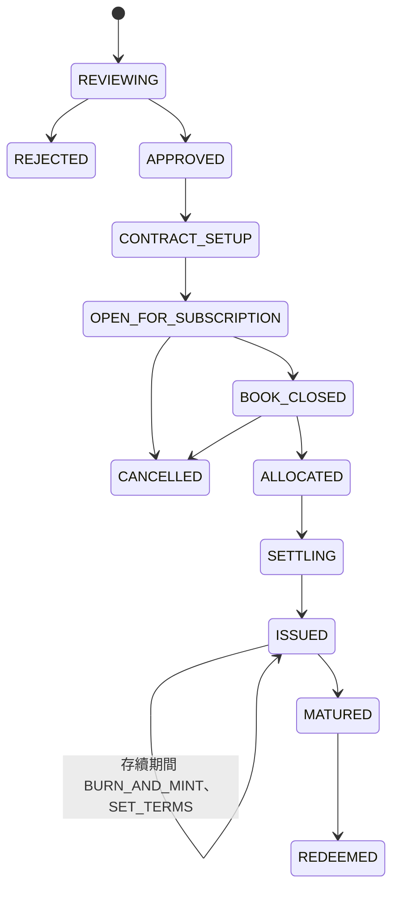

# DigiQuick bond 改用冷錢包 CMTAT：整體改動說明

- 日期：2026-11-24
- 線上版：https://claude.ai/artifact/VjrztvJniHZbBPMqGFn9Hd

## 1. 背景與目標架構

bond 改成由冷錢包系統部署和操作 CMTAT 合約，DigiQuick 不再持有任何私鑰、不再簽交易、也不再自己上鏈。DigiQuick 的角色是發行運營中樞：處理業務，再把每個業務動作轉成結構化的請求送給冷錢包；鏈上結果透過 webhook 和查詢取回。

依據是冷錢包 Open API 串接指南 v0.6（`dacc_chainfusion_docs/digiquick-integration-guide-v0.6.md`），以及對 digiquick-api、digiquick-admin、digiquick-app、digiquick-contracts 四個 repo 的程式碼核對。其他 8 種資產維持原本的 TokenFactory 路徑，不受影響。

| 職責 | DigiQuick | 冷錢包系統（Aegis） |
| --- | --- | --- |
| 簿記配售 | 開放認購、收認購單、分配、檢查發行量與最低面額 | — |
| 身份合規 | 機構 KYC、專業投資者認定、決定 allowlist 的開或關 | 審核客戶申請；登記外部地址時做 KYT |
| 交割編排 | 付款確認、付款後才產生 mint 請求、分批、排序 | — |
| 登記 | 鏈下持有人登記冊（權威）、三方對帳、記錄日快照 | 提供鏈上持有人、餘額、凍結狀態查詢 |
| 生命週期 | bond 狀態機、轉讓、修改條款、付息資料、到期贖回 | 暫停、凍結、強制轉移、停用（只能在 Aegis 後台操作） |
| 送出業務意圖 | 產生 referenceId、送請求、接 webhook、輪詢對帳 | 人工審核、簽名、廣播、記帳 |
| 私鑰與簽名 | 只有呼叫 API 用的 RSA 金鑰 | 所有錢包的私鑰、離線簽名、gas 支付 |

## 2. 已定的前提

- **投資人只收機構**，不收個人。
- **發行方和投資人走同一套 DigiQuick 註冊流程**：一律是「公司（`Company`）加上一或多位員工帳號（`Customer`）」，再依角色分流 KYC。
- **兩種用戶都在 APP（digiquick-app）看到發行和認購的債權狀況**，各自只看得到自己有權看的部分（第 5 節）。
- **簽名和廣播都在冷錢包系統**：admin 和 APP 都不再連接 MetaMask 或其他錢包。
- **只用託管錢包**：正式環境要等 Conflux 的 KYT 接上後才能登記外部地址和提領（指南 §7.2、§13），所以首發不開放外部地址。
- **指南 v0.6 的 API 全部還沒有實作**，欄位可能微調。開發先用 mock server，Aegis dev 環境可用後再驗證。
- 付款在鏈外：CMTAT 和冷錢包都不處理現金。預設採用先款後券（FoP）。
- **CMTAT 採用 3.0.0 版**。
- **同一家公司可以同時是發行方和投資人**，在冷錢包是兩個客戶（一個 ISSUER、一個 INVESTOR）。
- **同時是發行方和投資人的公司，不能認購自己發行的 bond**。

## 3. 要移除或繞開的既有鏈上邏輯

bond 新增 `issuanceChannel = VAULT_CMTAT` 後，下列程式對 bond 不再使用；對其他資產保留原狀。

| 現在的做法 | 位置 | bond 改成 |
| --- | --- | --- |
| admin 用 MetaMask 呼叫 `TokenFactory.createToken` 鑄幣 | `digiquick-admin/components/Asset/AssetMintBtn.tsx` | 送出部署和 `BATCH_MINT` 請求 |
| 設定 ERC20、持有期間的鏈上交易 | `AssetOwnershipBtn.tsx`、`AssetSetTimeBtn.tsx`、`handle-set-*-transaction.ts` | 不需要，CMTAT 沒有這兩種操作 |
| 交易請求表：逾時作廢、可以重送 | `digiquick-api/core/asset/services/asset-transaction-service.ts` | 另建 `VaultRequest` 表。冷錢包的 `TIMEOUT` 不是最終狀態，不能換 referenceId 重送 |
| listener 掃 TokenFactory 的交易和轉帳事件 | `core/contract-activity-task/tasks/transaction.ts`、`token-transfer-event.ts` | webhook 加上輪詢查詢 |
| metadata 上傳 IPFS、選 escrow 收款地址 | `core/asset/services/prepare-asset-deployment-service.ts` | 上傳條款 PDF；合約資訊用 `SET_INFORMATION`；收款對象是投資人託管錢包 |
| gas 價格、手續費 cron、ETH/USD 匯率 | `gas-price-provider.ts`、`cron-update-asset-transaction-fees.ts` | 不需要；改成監控冷錢包錢包的 CFX 餘額 |
| `Asset.status` 依鏈上交易推導 | `core/asset/models/asset.ts` 的 `get status()` | 加 CMTAT 分支，依 bond 生命週期與冷錢包請求推導（第 6 節） |
| admin、發行方、第三方用 `signMessage` 簽「資產內容證明」 | `AssetReviewBtn.tsx`、`AssetAcknowledgeBtn.tsx`、`core/asset/services/sign-asset-service.ts` | 建議改成 DigiQuick 內部雙人覆核；內容雜湊值用 `SET_INFORMATION` 寫上鏈 |
| 公司登記 MetaMask 地址（KYC 步驟 `ASSIGNING_WALLET_ADDRESS`） | `core/company/services/assign-wallet-address.ts` | 改成等冷錢包建好託管錢包（第 4 節） |

## 4. 註冊、身份與 KYC

現有註冊骨架可以直接沿用：`core/company/services/sign-up-service.ts` 一次建立 `Company` 和第一位 `Customer`，後續可以再加員工帳號，發行方和機構投資人都適用。要改的是公司在平台上的角色、KYC 步驟、以及對應到冷錢包的開戶。

### 4.1 註冊與欄位

- `Company` 加 `participantRoles`：`ISSUER`、`INVESTOR`，可以兩者都有。註冊時選擇；之後要加另一個角色，沿用 `request-new-asset-types` 的「申請後由 admin 審核」模式。
- 只選 `INVESTOR` 時，`assetTypeIds` 改為選填。
- 共同新欄位：`incorporationNo`（申請冷錢包客戶時需要）、`contactEmail`。
- 投資人新欄位：機構投資人類別、專業投資者認定的證明文件與有效期限（放在現有的 DD 文件流程）、收款銀行帳戶（付息與贖回用）。
- APP 註冊頁 `pages/signUp/basicInfo.tsx` 加角色選擇和上述欄位；待審頁 `pending.tsx` 依角色顯示目前步驟。

### 4.2 KYC 步驟依角色分流

現有步驟是 `REVIEWING_COMPANY` → `REVIEWING_ASSET_TYPES` → `ASSIGNING_WALLET_ADDRESS` → `FINISHED`（`core/company/models/kyc-step.enum.ts`）。改成依角色各自推進：

| 步驟 | 發行方 | 機構投資人 |
| --- | --- | --- |
| 1 | `REVIEWING_COMPANY`：公司 KYC、AML | `REVIEWING_COMPANY`：公司 KYC、AML |
| 2 | `REVIEWING_ASSET_TYPES`：可發行的資產類別 | `REVIEWING_INVESTOR_ELIGIBILITY`：專業投資者認定 |
| 3 | `VAULT_ONBOARDING`：申請冷錢包發行方客戶，建 admin、maker、custodian、發行持有 4 個錢包 | `VAULT_ONBOARDING`：申請冷錢包投資人客戶，建託管錢包 |
| 4 | `FINISHED`：可以提交 bond | `FINISHED`：可以認購 |

- `VAULT_ONBOARDING` 由系統自動送出請求，等冷錢包 webhook 回傳 `COMPLETED` 才推進。被 `REJECTED` 時回到 admin 處理，不自動重送。
- 同一家公司兩個角色都有時，在冷錢包是**兩個不同的客戶**（一個 ISSUER、一個 INVESTOR），`externalId` 分別設成 `issuer-<companyId>`、`investor-<companyId>`。
- **要先跟 Aegis 確認**：指南 §7.2 的 `INVESTOR` 申請欄位是個人資料（`firstName`、`lastName`、`birthday`、`countryOfCitizenship`），指南 §1.1 也寫投資人是 individual。機構投資人要用公司資料申請，需要 Aegis 增加機構型的 INVESTOR 欄位。

## 5. 權限與資料可見範圍

**要先修的漏洞**：單筆查詢 `asset(id)` 只掛 `@ReadAuth()`，沒有檢查 `companyId`（`digiquick-api/core/asset/resolvers/query.asset.ts`）。投資人加入後，任何投資人都能用 ID 讀到其他發行方審核中的資產，包括審核紀錄、簽名和非公開文件。

| 誰 | 可以看到 |
| --- | --- |
| 發行方 | 自己的 bond 全部狀態、認購簿、分配、交割進度、持有人、冷錢包請求進度（含審核關卡 `review.aegisStage`） |
| 機構投資人 | 公開認購中的 bond 的公開欄位和公開文件；自己的認購、分配、付款狀態、持倉、付息與贖回紀錄、凍結等事件 |
| 兩個角色都有的公司 | 兩組畫面分開；看不到也不能認購自己發行的 bond |
| admin | 全部，依新增的 `AdminAction` 權限項 |

- 新增 `OfferingGuard`、`InvestorGuard`，和現有 `CompanyGuard` 並用。JWT payload 或 loader 要能取得公司的 `participantRoles`。
- GraphQL 拆成公開版 `BondOfferingDto` 和發行方版 DTO，不要共用 `AssetDto`，避免審核紀錄、簽名、非公開文件外洩。
- 投資人之間互相看不到。發行方能不能看到投資人明細，待定（第 10 節）。
- 建立認購時檢查：認購方公司不能是該 bond 的發行方公司（`Subscription` 的 service 層和 `OfferingGuard` 都要擋）。投資人的「可認購債券」列表也排除自己發行的 bond。
- 新增 `AdminAction`：`VIEW_OFFERINGS`、`MANAGE_OFFERINGS`、`MANAGE_ALLOCATIONS`、`CONFIRM_PAYMENTS`、`SUBMIT_VAULT_REQUESTS`、`MANAGE_INVESTOR_ELIGIBILITY`。

## 6. bond 的發行、認購與生命週期

bond 在現有的審核流程之後，新增面向投資人的認購、分配、交割與存續狀態；只有付款確認後才送出 mint。

審核中可以被拒絕（`REJECTED`）；截止簿記前發行方可以取消（`CANCELLED`）。下表列出每個狀態的進入條件、送給冷錢包的請求，以及 APP 上誰看得到。

| 狀態 | 代碼 | 進入條件 | 冷錢包請求 | APP 誰看得到 |
| --- | --- | --- | --- | --- |
| 審核中 | `REVIEWING` | 發行方提交 bond | — | 發行方 |
| 已核准 | `APPROVED` | admin 審核通過、發行方確認 | — | 發行方 |
| 建立合約 | `CONTRACT_SETUP` | 條款 PDF 定稿 | 上傳條款、`cmtat/deployments`、`GRANT_ROLE` × 6 | 發行方 |
| 開放認購 | `OPEN_FOR_SUBSCRIPTION` | 角色都已在鏈上生效、到達認購開始日 | — | 發行方；所有已通過認定的投資人（發行方公司本身除外） |
| 截止簿記 | `BOOK_CLOSED` | 到達截止日或發行方手動截止 | — | 發行方；已認購的投資人 |
| 已分配 | `ALLOCATED` | 分配表覆核通過，合計等於發行量 | `BATCH_SET_ALLOWLIST` | 發行方；獲配的投資人 |
| 交割中 | `SETTLING` | 至少一位投資人付款已確認 | 依到帳分批送 `BATCH_MINT` | 發行方；獲配的投資人 |
| 已發行 | `ISSUED` | 全部 mint 完成且三方對帳一致 | 存續期間：`BURN_AND_MINT`、`SET_TERMS`、`SET_INFORMATION` | 發行方；持有人 |
| 已到期 | `MATURED` | 到期日 | — | 發行方；持有人 |
| 已贖回 | `REDEEMED` | 本金付款確認 | `BATCH_BURN` | 發行方；原持有人 |

- 認購與分配在付款之前，只存在 DigiQuick；冷錢包只看到 allowlist 和 mint。
- `Asset.status` 對 bond 改成由這個狀態機推導，而不是由 `AssetTransaction` 推導。
- Aegis 後台的暫停、凍結、強制轉移、停用收到 webhook 後，記錄事件、更新登記冊並告警；這些事件不改變上面的主狀態。

## 7. 冷錢包整合

業務事件先變成 DigiQuick 的「業務意圖」，再拆成一或多筆冷錢包請求；結果回來後反向推進意圖和 bond 狀態。新模組放在 `digiquick-api/core/vault/`。

1. 業務事件（例如分配已確認、款項已到帳）產生 `BusinessIntent`。
2. 意圖拆成 1..N 筆 `VaultRequest`，每筆有固定 referenceId，對象每批最多 20 個。
3. API client 送出，冷錢包回 `202`。
4. webhook 或輪詢更新 `VaultRequest` 的狀態。
5. 全部請求到最終狀態後，推進 `BusinessIntent` 和 bond 狀態，並更新登記冊。

### 7.1 業務意圖與冷錢包 API 對應

| 業務意圖 | 冷錢包 API | 觸發時機 |
| --- | --- | --- |
| 發行方開戶 | `POST /v1/client-requests` kind=ISSUER，再 `POST /v1/clients/{id}/wallets` × 4 | 發行方 KYC 通過 |
| 機構投資人開戶 | kind=INVESTOR，再建託管錢包 | 投資人認定通過 |
| 建立債券合約 | 上傳條款 → `cmtat/deployments` → `GRANT_ROLE` × 6（依序）→ 查詢確認角色 | bond 核准後、開放認購前或交割前 |
| 投資人准入或撤銷 | `BATCH_SET_ALLOWLIST` | 分配確定後；認定失效時關閉 |
| 交付（付款後交券） | `BATCH_MINT` 到投資人託管錢包 | 付款確認後 |
| 轉讓、換錢包 | `BURN_AND_MINT` | 轉讓審核通過 |
| 修改條款或合約資訊 | `SET_TERMS`、`SET_INFORMATION` 等 | 條款變更核准 |
| 贖回或註銷 | `BATCH_BURN` | 本金付款確認後 |

### 7.2 基礎元件

- **API client**：RSA-PSS（SHA-256、salt 32），簽章字串的 path 含 query string。重試時換 nonce 和 timestamp，不換 referenceId。429 依 `Retry-After` 等待，自己限流在每分鐘 120 次內。
- **webhook endpoint**：放在 main app。用原始 body 驗 HMAC-SHA256；同一個 DB transaction 內用 `callbackId` 去重，只在 `seq` 較大時更新；10 秒內回應。
- **對帳 cron**：放在 listener 的 `apps/listener/src/register-cron-jobs.ts`。查詢還沒到最終狀態的請求，補查送達失敗的 webhook，定期拉 holders 和登記冊比對。
- **排隊**：同一個錢包的代幣異動、同一檔代幣的角色指派，前一筆有結果才送下一筆（指南 §7.6）。
- **即時推送**：狀態推進時用 APP 既有的 `graphql-ws` 推給相關的發行方和投資人。

### 7.3 錯誤處理規則

| 情況 | 處理 |
| --- | --- |
| `retryable: true`（429、`REQUEST_IN_PROGRESS`、502 類） | 稍後用**同一個** referenceId 重試 |
| `TIMEOUT` | 不是最終狀態；只查詢，不重送，時間太長就告警並聯絡 Aegis |
| `409 REQUEST_STATE_UNKNOWN`、`502 KV_UNAVAILABLE` | 不換 referenceId；等 Aegis 處理後的最終狀態 |
| `REJECTED` 且 `rejection.code = TECHNICAL_RETRY`；或 `FAILED` 且 `failure.code = REQUEST_ABANDONED` | 可以用**新的** referenceId 重送 |
| 一般審核拒絕（`rejection.code` 為 null） | 不自動重送；進例外佇列人工處理 |
| `FAILED`（其他原因，例如 gas、allowlist） | 查明原因、修正後用新的 referenceId 重送 |
| `400`、`422` | 不重試；`422` 會佔用 referenceId |

## 8. 資料模型變更

| 表 | 類型 | 內容 |
| --- | --- | --- |
| `Company` | 修改 | 加 `participantRoles`、`incorporationNo`、`contactEmail` |
| `KycStep` enum | 修改 | 加 `REVIEWING_INVESTOR_ELIGIBILITY`、`VAULT_ONBOARDING`；KYC 紀錄要區分角色 |
| `InvestorProfile` | 新增 | 投資人類別、專業投資者認定狀態與有效期限、收款銀行帳戶 |
| `AssetDb` | 修改 | 加 `issuanceChannel`（`TOKEN_FACTORY`、`VAULT_CMTAT`） |
| `BondAssetDb` | 修改 | 加 `isin`、`decimals`、`termsDocumentId`、`recordDate`；`paymentDates`、`dayCount` 若要系統計息需結構化 |
| `Offering` | 新增 | 認購期間、最低面額、發行量上限、交割日、狀態 |
| `Subscription` | 新增 | 投資人、認購金額、狀態、提交人 |
| `Allocation` | 新增 | 投資人、分配金額、覆核人 |
| `Settlement` | 新增 | 應付金額、付款確認人與時間、對應的 mint 請求 |
| `RegisterEntry`、`HoldingSnapshot` | 新增 | 鏈下登記冊異動、記錄日快照、對帳結果 |
| `VaultClient` | 新增 | 公司 × 角色 → 冷錢包 `clientId`、`externalId` |
| `VaultWallet` | 新增 | `walletId`、地址、用途（admin、maker、custodian、發行持有、託管） |
| `CmtatToken` | 新增 | bond → `cmtatTokenId`、合約地址、角色狀態 |
| `BusinessIntent` | 新增 | 意圖類型、業務對象、狀態 |
| `VaultRequest` | 新增 | referenceId（唯一）、operationType、status、最後的 `seq`、結果與錯誤 |
| `VaultCallback` | 新增 | `callbackId`（唯一），用來去重 |
| `VaultOperationEvent` | 新增 | Aegis 後台的暫停、凍結、強制轉移、停用事件 |

所有新 entity 要在 `database/all-entities.ts` 註冊，並手寫 migration。

## 9. 各 repo 的改動清單

### digiquick-api

- 新模組 `core/vault/`（client、webhook controller、請求與意圖 service、對帳 cron），以及 `core/offering/`（認購、分配、交割）、`core/register/`（登記冊、快照）。依專案慣例分 `dto`、`models`、`repositories`、`services`、`resolvers`，並在 `tsconfig.json` 加 `@@vault/*` 等別名。
- 註冊與 KYC：`sign-up-service.ts`、`kyc-service.ts`、`kyc-step.enum.ts`、`dd-document-service.ts` 依第 4 節修改。
- 權限：修 `query.asset.ts` 的 `asset(id)`；新增 guard 與 `AdminAction`。
- bond：`create-bond-asset.ts`、bond DTO 加新欄位；`asset.ts` 的 `get status()` 加 CMTAT 分支；`asset-query.repo.ts` 載入新關聯。
- email：新增投資人與發行方事件模板（KYC 通過、開放認購、分配結果、付款提醒、已交付、付息、贖回、凍結）。
- 設定：env 加冷錢包 API key、私鑰（放 Secrets Manager）、webhook secret、base URL；`common/providers/network.ts` 加 Conflux eSpace 主網。
- 測試：修好 `apps/main/test` 的 jest，為簽章、webhook、狀態機和錯誤規則寫單元測試；建立冷錢包 mock server。

### digiquick-app

- 註冊頁與待審頁依第 4 節修改。
- 側邊欄依角色顯示。**發行方**：提交 bond（`components/Bond/BondAddBtn.tsx` 加 ISIN、decimals、條款 PDF）、發行進度、認購簿、分配、持有人。**投資人**：可認購債券、我的認購、我的持倉、付息與贖回紀錄。
- 新 hooks：`useOfferings`、`useCreateSubscription`、`useMyHoldings` 等；用 `graphql-ws` 訂閱狀態。
- 跑 `yarn codegen` 更新 `utils/hooks/types.ts`、`possibleTypes.ts`。

### digiquick-admin

- bond 詳情隱藏 `AssetMintBtn`、`AssetOwnershipBtn`、`AssetSetTimeBtn`，改成「CMTAT 發行」步驟面板（每筆請求的 referenceId、狀態、審核關卡、txHash）。
- 新增：投資人認定審核、角色申請審核、認購簿總覽、分配覆核、付款確認、例外佇列（被拒、失敗、逾時）、持有人快照與對帳。
- `AssetReviewBtn`、`AssetAcknowledgeBtn` 對 bond 不再要求 `signMessage`，改成雙人覆核。
- 新權限項加進權限管理頁；跑 `yarn codegen`。

### digiquick-contracts

- 不需要改。bond 的 CMTAT 合約由冷錢包系統部署；TokenFactory 繼續服務其他資產。

## 10. 待確認事項

**Aegis**

- [ ] `INVESTOR` 客戶能不能用機構資料申請？指南 v0.6 只有個人欄位。這項決定註冊欄位和 `VaultClient` 的設計，最先確認。
- [ ] CMTAT 3.0.0 的細節（目前指南沒有寫）：部署的 request body、`GRANT_ROLE` 是哪 6 個角色、審計證據、decimals。
- [ ] 審核 SLA，以及 dev、stg、主網的交付日期。
- [ ] CFX gas 由誰出、誰補充。

**業務**

- [ ] 發行方能不能看到每位投資人的身份和認購金額，還是只看彙總？
- [ ] 分配由發行方在 APP 決定、admin 覆核；還是由安排行或 admin 決定？
- [ ] 專業投資者認定由 DigiQuick 審核，還是採用券商的認定結果？
- [ ] 付息與贖回金額由付款代理計算，還是由 DigiQuick 計算？
- [ ] 持有人的正式紀錄以鏈下登記冊為準（本文件的預設），需要律師確認。

## 11. 建議的實施順序

1. 修 `asset(id)` 權限漏洞，不用等其他決策。
2. 向 Aegis 確認第 10 節的前兩項（機構投資人、CMTAT 3.0.0 細節）。
3. 冷錢包基礎元件：API client、`VaultRequest`、webhook、對帳 cron、mock server。
4. 註冊與 KYC 分流、`VAULT_ONBOARDING`（發行方與投資人開戶）。
5. bond 新欄位、`issuanceChannel`、CMTAT 建立流程（條款、部署、角色）。
6. 認購、分配、付款確認、allowlist、`BATCH_MINT`，以及 APP 的發行方與投資人畫面。
7. 登記冊、持倉快照與三方對帳；Aegis 後台事件落地。
8. 存續操作：`BURN_AND_MINT`、`SET_TERMS`；到期贖回 `BATCH_BURN`。

第 3 到 6 步可以先在 mock server 上完成，Aegis dev 環境可用後再做端到端驗證。工時估算見同目錄的 `bond-cmtat-aegis-estimate-report.md`；該報告未包含投資人前台，這部分要另外加上。
